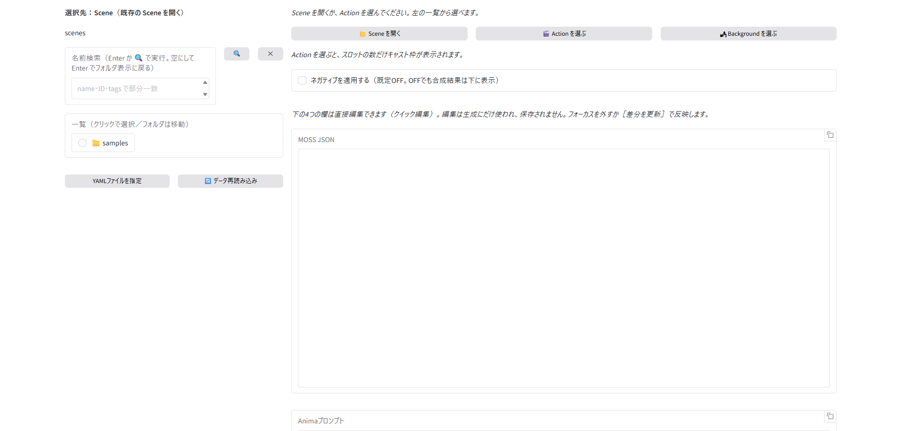
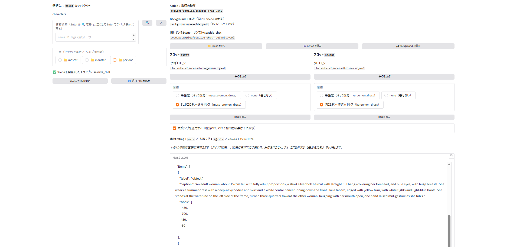
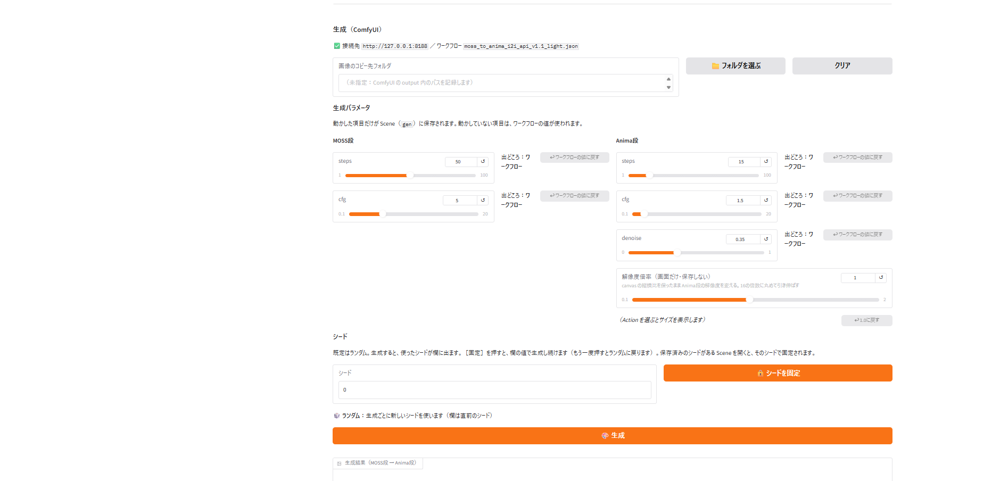

# ビルダーの画面ガイド

ビルダー（`app.py`、既定ポート 7860）の画面を、ボタンごとに説明します。
機能の細かい決まりは [`README.md`](../README.md) と [`spec_v2/SPEC.md`](../spec_v2/SPEC.md) の10章・13章にあります。

画面は大きく次の4つに分かれています。

| 場所 | 役割 | 図 |
|---|---|---|
| 左の列（共有ブラウザ） | データを選ぶ。右の列のボタンで「何を選ぶか」が切り替わる | 図1・図2 |
| 右の列・上 | Scene・Action・Background の状態と、キャスト枠 | 図1・図2 |
| 右の列・中 | 組み立てたプロンプト（クイック編集もここ） | 図1・図2 |
| 右の列・下 | 生成（ComfyUI）、シーンの保存・書き出し | 図3 |

---

## 図1　起動直後

起動すると、左の一覧は「Scene を開く」状態になっています。

### 左の列（共有ブラウザ）

| 表示・ボタン | 説明 |
|---|---|
| **選択先：〜** | 今、左の一覧で選ぶと何に入るかを表しています（例：「Scene（既存の Scene を開く）」「`first` のキャラクター」）。右の列の［Scene を開く］［キャラを選ぶ］などを押すと切り替わります |
| **ルート名**（`scenes` など） | 今見ているデータの種類（`scenes`・`actions`・`backgrounds`・`characters`・`outfits`）です。その下にパンくずが出て、今いるフォルダが分かります |
| **名前検索** | name・id・tags の部分一致で、ルート全体から探します。Enter か［🔍］で実行し、結果には所属フォルダのパスが付きます。結果は最大100件です |
| **［✕］** | 検索を消して、フォルダの表示に戻ります（検索欄を空にして Enter でも戻ります） |
| **一覧** | クリックすると、ファイルなら選択、📁 フォルダならその中へ移動します。フォルダ名は `_folder.yaml` の表示名で、並び順は `order` が優先です |
| **［YAMLファイルを指定］** | ファイル選択ダイアログで YAML を直接選びます。ファイルの `id` から、データフォルダ内の元のファイルを特定します |
| **［🔄 データ再読み込み］** | YAML をエディタや手で編集した後に押すと、データを読み直します |

### 右の列

| 表示・ボタン | 説明 |
|---|---|
| **［📂 Scene を開く］** | 左の一覧を `scenes` に切り替えます。保存済みの Scene を開くときに使います |
| **［🎬 Action を選ぶ］** | 左の一覧を `actions` に切り替えます。Action を選ぶと、新しい Scene の組み立てが始まります |
| **［🏞 Background を選ぶ］** | 左の一覧を `backgrounds` に切り替えます。背景はいつでも選び直せます |
| **ネガティブを適用する** | オンにすると、合成したネガティブを生成に使います（既定はオフ）。オフでも合成結果は下に表示されます |
| **MOSS JSON・Anima プロンプト ほか** | 組み立てたプロンプトが出ます。Scene か Action を選ぶまでは空です（図2） |

---

## 図2　Scene を開いたところ

Scene を開くか Action を選ぶと、上に今の組み合わせ、その下にキャスト枠が出ます。

### 状態の表示（右の列・上）

| 表示 | 説明 |
|---|---|
| **Action：〜** | 使っている Action の表示名と、ファイルの場所 |
| **Background：〜** | 使っている背景と、そのキャンバスの大きさ・rating。（開いた Scene の背景）（Action の推奨背景）など、どこから来た背景かも出ます |
| **開いている Scene：〜** | 開いている Scene の表示名と、ファイルの場所。新しく組み立て中のときは出ません |

### キャスト枠（スロットごと）

Action の `slots` の数だけ枠が並びます（図では `first` と `second` の2つ）。

| 表示・ボタン | 説明 |
|---|---|
| **スロット名** | Action で決められた枠の名前です |
| **キャラ名とファイルの場所** | 今このスロットに入っているキャラクター |
| **［キャラを選ぶ］** | 左の一覧が `characters` に切り替わり、選択先が「このスロットのキャラクター」になります。一覧で選ぶと入れ替わります |
| **服装（3択）** | **未指定**：下の順で決まる服装を使います（Scene → Action の服装指定 → キャラの `defaultOutfit`）。かっこ内に、実際に使われる服装と出どころが出ます（例：「未指定（キャラ既定：…）」）／**none**：服を着せません／**個別の服装**：［服装を選ぶ］で選んだ服装を使います |
| **［服装を選ぶ］** | 左の一覧が `outfits` に切り替わります。選んだ服装が3択の3つ目に入り、選ばれた状態になります |

左の一覧の下に「✅ Scene を開きました」のような、直前の操作の結果が出ます。

### プロンプトの表示（右の列・中）

| 表示・ボタン | 説明 |
|---|---|
| **実効 rating ／ 人数タグ ／ canvas** | 背景と Action の rating のうち厳しい方、キャストから自動で作られた人数タグ（`2girls` など）、画像の大きさです |
| **MOSS JSON・Anima プロンプト・ネガティブ** | 組み立てたプロンプトです。右上の［⧉］でコピーできます |
| **クイック編集** | この4つの欄は直接書き換えられます。書き換えた内容は生成にだけ使われ、保存はされません。欄からカーソルを外すか［差分を更新］を押すと、変えたところが色付き（追加は緑、削除はグレーの取り消し線）で下に出ます。くわしくは README の「クイック編集」 |
| **［コンパイル結果に戻す］** | 編集した欄にだけ出ます。書き換えを取り消します |

> キャストや服装、Action・Background を変えると、プロンプトが組み立て直され、クイック編集の内容はリセットされます（直前の差分は「破棄された編集の差分」として残ります）。

---

## 図3　生成（ComfyUI）

プロンプトの下にある、ComfyUI で画像を作る部分です。ComfyUI を先に起動しておいてください。

### 接続と画像の保存先

| 表示・ボタン | 説明 |
|---|---|
| **接続先 ／ ワークフロー** | ✅ なら ComfyUI につながっていて、表示のワークフローで生成します。設定に問題があると理由が出て、［生成］は押せません |
| **画像のコピー先フォルダ** | 空のままなら、ComfyUI の output フォルダ内のパスを記録します |
| **［📁 フォルダを選ぶ］** | 生成した画像をコピーするフォルダを選びます。選ぶと、そこへ保存したパスが記録されます |
| **［クリア］** | コピー先の指定を外します |

### 生成パラメータ

MOSS 段（1段目）の steps・cfg と、Anima 段（2段目、i2i）の steps・cfg・denoise を変えられます。

| 表示・ボタン | 説明 |
|---|---|
| **スライダーと数値欄** | 値を変えます。**動かした項目だけ**が Scene の `gen` に保存され、動かしていない項目はワークフローの値が使われます |
| **［↺］**（数値欄の右） | Gradio 標準の「初期値に戻す」ボタンです。Scene に保存される値を確実にワークフローの値へ戻したいときは、右の［↩ ワークフローの値に戻す］を使ってください |
| **出どころ** | その値がどこから来ているか（「ワークフロー」か「Scene」）です |
| **［↩ ワークフローの値に戻す］** | その項目を Scene の `gen` から外し、ワークフローの値に戻します。値を動かしたときだけ押せます |
| **解像度倍率**（Anima 段） | Anima 段の解像度を 0.1〜2.0 倍にします。キャンバスの縦横比は保ち、16の倍数に丸めます。**画面だけの設定**で、保存されません。Action を選ぶと、実際のサイズが下に出ます |
| **［↩ 1.0 に戻す］** | 解像度倍率を 1.0 に戻します |

### シード

| 表示・ボタン | 説明 |
|---|---|
| **シード欄** | 既定はランダムで、生成すると使ったシードがここに出ます。ランダムのときは表示用で、生成には使いません |
| **［🔒 シードを固定］** | 欄の値で固定し、同じシードで生成し続けます。もう一度押すとランダムに戻ります（欄の値は残ります）。保存済みのシードがある Scene を開くと、そのシードで固定された状態になります |
| **状態の表示** | 「🎲 ランダム」か「🔒 固定」かが出ます |

### 生成と結果

| 表示・ボタン | 説明 |
|---|---|
| **［🎨 生成］** | ComfyUI に送って、MOSS 段 → Anima 段の順に画像を作ります |
| **生成結果（MOSS段 → Anima段）** | 2枚の画像が並びます。Anima 段だけが失敗したときは、MOSS 段の画像が残り、［🔁 Anima段だけ再試行］が出ます（同じシード・同じ設定で Anima 段だけ送り直します） |

---

## 画面のさらに下

図3より下には、次のブロックがあります。使い方は README の各節にあります。

| ブロック | 内容 | README の節 |
|---|---|---|
| **シーンを保存** | ［上書き保存］［別名で保存］、保存先のフォルダ選び、［＋フォルダ作成］ | Scene の保存ルール |
| **シーンを書き出す（zip）** | 開いている Scene 1つ、またはフォルダ一括を、依存データごと zip にします | Scene の書き出し（zip） |
| **フォルダ情報の編集** | `scenes/` のフォルダの表示名・説明・並び順（`order`）を編集します | フォルダ情報の編集（`_folder.yaml`） |

## よくある流れ

1. ［📂 Scene を開く］で Scene を開く（新しく作るなら［🎬 Action を選ぶ］）
2. 各スロットの［キャラを選ぶ］［服装を選ぶ］でキャストを入れ替える
3. 必要なら生成パラメータやシードを調整して［🎨 生成］
4. 気に入ったら、下の「シーンを保存」で［上書き保存］か［別名で保存］
