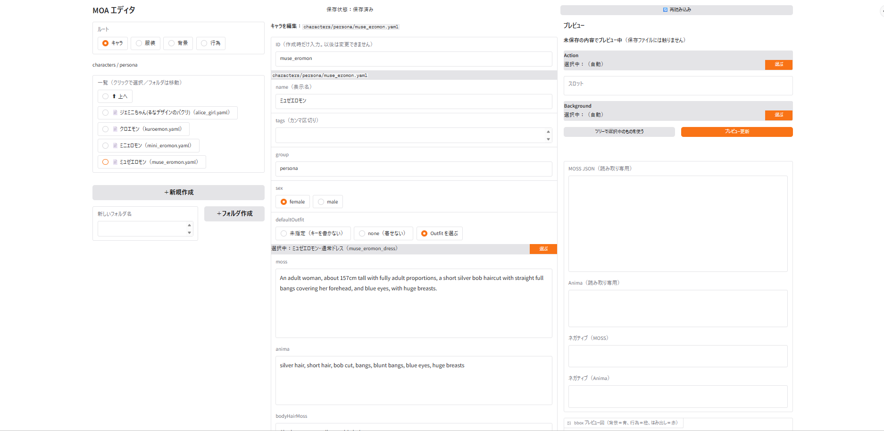
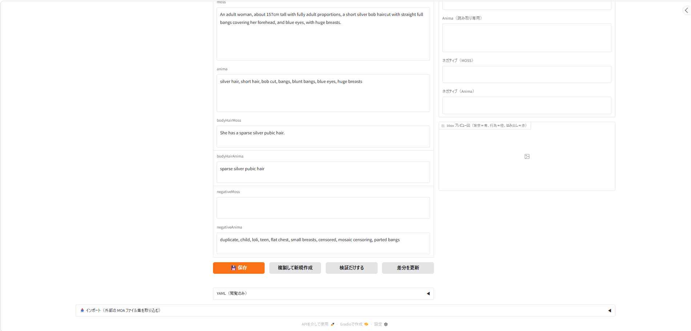

# エディタの画面ガイド

エディタ（`editor.py`、既定ポート 7863）の画面を、ボタンごとに説明します。ここではキャラクター（Character）を編集する画面を例にしています。
機能の細かい決まりは [`README.md`](../README.md) の「エディタ」と [`spec_v2/EDITOR_SPEC.md`](../spec_v2/EDITOR_SPEC.md) にあります。

画面は3つの列に分かれています。

| 列 | 役割 |
|---|---|
| 左 | 編集するデータを選ぶ（ツリー）。新規作成とフォルダ作成 |
| 中央 | 選んだデータの編集フォームと、保存などのボタン |
| 右 | 編集中の内容でのプレビュー（保存しなくても見られる） |

> エディタで編集できるのは **ID 以外の項目と、新規追加だけ**です。ID の変更・削除・ファイルの移動はできません。

---

## 図1　画面の上半分

### 一番上

| 表示・ボタン | 説明 |
|---|---|
| **保存状態** | 「保存済み」か「● 未保存の変更あり」かが出ます |
| **［🔄 再読み込み］**（右上） | データを読み直します。VS Code などで YAML を直接直したときや、ビルダーで保存したあとに押します |

### 左の列（ツリー）

| 表示・ボタン | 説明 |
|---|---|
| **ルート** | 編集する種類を選びます：**キャラ**（characters）・**服装**（outfits）・**背景**（backgrounds）・**行為**（actions）。Scene はビルダーで編集します |
| **パンくず**（`characters / persona` など） | 今いるフォルダです |
| **一覧** | ファイルをクリックすると、中央のフォームにその内容が開きます。📁 フォルダならその中へ、［⬆ 上へ］で1つ上のフォルダへ移動します。表示は「表示名（ファイル名）」です |
| **［＋新規作成］** | 今いるフォルダに、今のルートの種類の新しいデータを作ります。フォームが空の状態（初期値）で開き、ID を入力できるようになります |
| **新しいフォルダ名 ＋［＋フォルダ作成］** | 今いるフォルダの中に新しいフォルダを作ります。Windows で使えない名前や、先頭が `_` や `.` の名前は作れません |

> 未保存の変更があるときに別のデータを開こうとすると、確認が出て止まります（勝手に移動しません）。

### 中央の列（編集フォーム：キャラの場合）

| 項目 | 説明 |
|---|---|
| **キャラを編集：<ファイルの場所>** | 今開いているファイルです |
| **ID** | 作成するときだけ入力できます。以後は変更できません（読み取り専用で表示） |
| **name（表示名）** | 一覧やピッカーに出る名前です |
| **tags（カンマ区切り）** | 検索用のキーワードです。`ポケモン, BW` のようにカンマで区切って入れます |
| **group** | 同じ人物の別形態（衣装違い・髪型違いなど）をまとめるための分類です |
| **sex** | `female` か `male`。人数タグ（`1girl`・`1boy` など）を自動で作るときに使います |
| **defaultOutfit（3択）** | このキャラの既定の服装です。**未指定（キーを書かない）**：既定の服装なし／**none（着せない）**：明示的に服を着せない／**Outfit を選ぶ**：下の［選ぶ］で服装を選びます |
| **選択中：〜 ［選ぶ］** | 「Outfit を選ぶ」にしたときの、今選んでいる服装です。［選ぶ］を押すと、フォルダをたどって選べるピッカーが開きます（名前検索もできます） |
| **moss** | MOSS 用の容姿の文章です。頭部のアクセサリー（ヘッドホンなど）もここに書きます |
| **anima** | Anima 用の容姿のタグです |

---

## 図2　画面の下半分

### 中央の列（フォームの続きとボタン）

| 項目・ボタン | 説明 |
|---|---|
| **bodyHairMoss ／ bodyHairAnima** | 体毛の文章（MOSS 用、主語を含む完全な文）とタグ（Anima 用）です。Action で `{{スロット名.bodyHair}}` を使ったときだけ差し込まれます。空なら何も入りません |
| **negativeMoss ／ negativeAnima** | このキャラ固有のネガティブです。別の髪型・髪色を避けたいときなどに使います |
| **［💾 保存］** | 検証してから保存します。エラーがあれば保存せず、理由を表示します（警告だけなら保存できます）。コメントやキーの順番は残したまま、変えた項目だけを書き換えます |
| **［複製して新規作成］** | 今の内容をコピーした新規作成フォームを開きます。ID の初期値は `<元のid>_copy` です。形態違いのキャラを作るときに便利です |
| **［検証だけする］** | 保存せずに、エラーや警告がないかだけを確かめます |
| **［差分を更新］** | 「変えたところ」の色付き表示を更新します（欄からカーソルを外したときにも自動で更新されます） |
| **YAML（閲覧のみ）** | 開くと、ファイルの中身をそのまま見られます。ここでは編集できません |

> 欄を書き換えると、その欄のすぐ下に変えたところが色付き（追加は緑の背景、削除はグレーの取り消し線）で出ます。保存ボタンの近くには「保存前の変更点」として、変えた項目がまとめて出ます。変更が無いときは出ません。

### 右の列（プレビュー）

編集中の内容を、実際の Action に当てはめたらどうなるかを確かめられます。**保存しなくても使え、ファイルには触りません**。

| 表示・ボタン | 説明 |
|---|---|
| **Action ／ 選択中 ［選ぶ］** | プレビューに使う Action です。「（自動）」のときは、このキャラを使っている Scene の Action（無ければ一覧の先頭）が使われます。［選ぶ］で自分で選べます |
| **スロット** | 編集中のキャラを、Action のどのスロットに入れるかを選びます。ほかのスロットは、その Action を使っている Scene のキャスト（無ければ一覧の先頭のキャラ）で自動的に埋められ、そのことが表示されます |
| **Background ／ 選択中 ［選ぶ］** | プレビューに使う背景です。「（自動）」なら Action の推奨背景です |
| **［ツリーで選択中のものを使う］** | 左のツリーで選んでいるものを、プレビューの選択に使います |
| **［プレビュー更新］** | 押したときにだけ、プレビューを作り直します（入力するたびには更新しません） |
| **MOSS JSON ／ Anima ／ ネガティブ（MOSS・Anima）** | 組み立てた結果です（読み取り専用）。ネガティブは、適用のオン・オフに関係なく合成結果を出します |
| **bbox プレビュー図** | 人物や物の配置（bbox）を図で見られます。色は 背景＝青、行為＝橙、はみ出し＝赤 です |

---

## ほかの種類を編集するとき

ルートを切り替えると、フォームの項目がその種類のものに変わります。

| 種類 | キャラとの主な違い |
|---|---|
| **服装** | name・tags・moss（「She wears 〜.」まで含めた完全な文）・anima・ネガティブだけのシンプルなフォームです |
| **背景** | `rating`・`canvas`（画像の大きさ）・`metaTags`・`mossCaption`（背景の文章）と、**mossItems のカード**（情景の物と bbox）があります。プレイスホルダーは使えません。使用中の背景を保存すると、上書きせずに**複製として保存**します |
| **行為** | `slots`・スロットごとの服装・`extras`（キャスト以外の人数）・推奨背景・`mossCaption` と **mossItems のカード**があり、`{{スロット名}}` などのプレイスホルダーを使います。使用中の行為は上書き保存し、参照している Scene の一覧を確認に出します |

mossItems のカードは、1枚が1つのアイテム（label・caption・bbox）で、［↑］［↓］で並べ替え、［削除］で消し、［アイテム追加］で増やします（最大8枚）。

## 画面の一番下

| ブロック | 内容 |
|---|---|
| **📥 インポート** | 外部で作った MOA ファイル集（`.yaml` か `.zip`、またはフォルダ）を、検査してから既存のフォルダに追加します。既存のファイルは上書きしません。使い方は README の「インポート」の節 |
